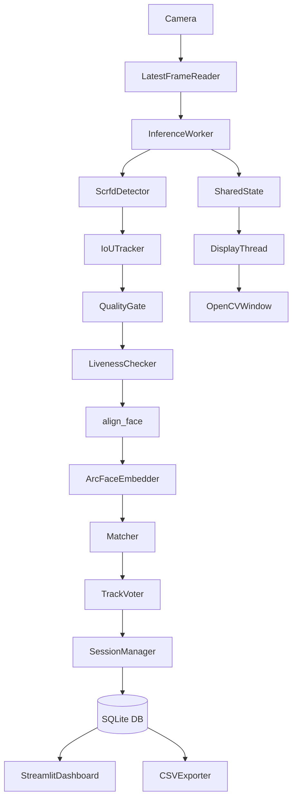

# System Architecture

> **Project:** Face Recognition Attendance System — CSE 471 (Deep Learning for Computer Vision)  
> **Semester:** 5

---

## Pipeline Diagram



---

## Component Descriptions

### Camera
The video source. Accepts any OpenCV-compatible input: USB webcam, IP camera URL, or virtual camera device (DroidCam, IriunWebcam). Configured via `config.yaml → camera.source`.

---

### LatestFrameReader
**File:** `app/capture/reader.py`

A background thread that continuously reads frames from the camera and writes only the **most recent frame** to a thread-safe single-slot buffer. This decouples camera I/O from inference timing: even if inference is slow, the displayed and processed frame is always the latest available, preventing queue buildup and latency drift.

- Buffer size: 1 (always latest)
- Thread: daemon thread, starts with the application
- Provides: `reader.read() → np.ndarray | None`

---

### InferenceWorker
**File:** `app/pipeline/worker.py`

The central orchestrator thread that drives the per-frame recognition pipeline. It:
1. Reads the latest frame from `LatestFrameReader`
2. Passes it through the vision pipeline (detection → tracking → quality → liveness → embedding → matching → voting)
3. Pushes annotated results to `SharedState` for the display thread

Runs in a separate thread from the display, allowing the display to render at a higher FPS than inference produces.

---

### ScrfdDetector
**File:** `app/vision/detector.py`  
**Model:** SCRFD-10GF (ONNX)

Sample and Computation Redistribution Face Detector (SCRFD). Detects all faces in a frame and returns bounding boxes and 5-point facial landmarks (eye corners, nose tip, mouth corners) per detection.

- Input: BGR frame (any resolution; internally resized to 640 × 640)
- Output: `[(bbox: [x1,y1,x2,y2], confidence: float, landmarks: [[x,y]×5])]`
- Threshold: configurable via `config.yaml → detection.conf_threshold`

---

### IoUTracker
**File:** `app/vision/tracker.py`

A lightweight IoU-based multi-object tracker. Associates detections across consecutive frames by computing bounding box Intersection-over-Union (IoU). Assigns a persistent `track_id` to each tracked face, enabling the `TrackVoter` to accumulate votes per individual over time.

- Algorithm: greedy IoU matching (Hungarian not required at this scale)
- Max age: configurable `max_age` frames before a track is considered lost
- Provides stable `track_id` even under brief detection gaps

---

### QualityGate
**File:** `app/vision/quality.py`

Filters out face crops that are unsuitable for reliable recognition. Checks:

| Check | Metric | Default Threshold |
|---|---|---|
| Minimum face size | Bounding box area | `min_face_px = 80` px |
| Sharpness | Laplacian variance | `min_laplacian = 50.0` |
| Brightness | Mean pixel value | `[20, 250]` |
| Pose (yaw) | Landmark geometry | `max_yaw_deg = 30°` |
| Pose (pitch) | Landmark geometry | `max_pitch_deg = 25°` |

Frames that fail any check are skipped for that inference cycle; the display thread still shows the detection bounding box annotated as "quality fail".

---

### LivenessChecker
**File:** `app/vision/liveness.py`  
**Model:** MiniFASNet (Silent-Face Anti-Spoofing v2, ONNX)

Passive single-frame anti-spoofing. Classifies the face crop as **real** or **spoof**. Returns a `real_score` in `[0, 1]`; threshold configurable via `config.yaml → liveness.threshold`.

- Input: 80 × 80 face crop
- Output: `(is_real: bool, real_score: float)`
- Spoof types mitigated: printed photos, low-quality screen replays
- Known gap: does not reliably detect 3-D masks or high-quality deepfakes (see `known_limitations.md §1`)

---

### align_face
**File:** `app/vision/alignment.py`  
**Function:** `align_face(img, landmarks) → np.ndarray`

Performs **similarity transform alignment** (rotation + scale, no shear) using the 5 detected landmarks to map the face into a canonical 112 × 112 pixel coordinate system. This normalises pose variation before embedding, significantly improving ArcFace recognition accuracy.

- Reference template: ArcFace standard 112 × 112 canonical coordinates
- Transform: `cv2.estimateAffinePartial2D` + `cv2.warpAffine`
- Output: 112 × 112 × 3 uint8 RGB image

---

### ArcFaceEmbedder
**File:** `app/vision/embedder.py`  
**Model:** ArcFace R100 trained on MS1MV2 (ONNX)

Converts the aligned 112 × 112 face image into a **512-dimensional L2-normalised embedding vector**. The embedding space is trained with the ArcFace additive angular margin loss, which creates compact intra-class clusters and large inter-class margins.

- Input: 112 × 112 × 3 (normalised to `[-1, 1]`)
- Output: 512-D float32 vector, L2-normalised to unit sphere
- CPU latency: ~180 ms (see `known_limitations.md §9`)

---

### Matcher
**File:** `app/matching/matcher.py`

Compares the query embedding against all enrolled embeddings using **cosine distance** (equivalent to dot product on the unit sphere). Returns the best-matching student ID and score, or `Unknown` if the minimum distance exceeds the threshold.

- Distance metric: `d = 1 − (e_query · e_gallery)`
- Threshold: configurable `config.yaml → matching.threshold` (default ≈ 0.35)
- Complexity: O(N) linear scan over enrolled embeddings
- Gallery loaded from SQLite at startup; reloaded on enrollment events

---

### TrackVoter
**File:** `app/matching/voter.py`

Accumulates per-track recognition results over a sliding window of `window_size` inference frames. Applies a **majority vote**: if the plurality student ID accounts for ≥ `min_votes_fraction` of non-None votes, the identity is confirmed. Also applies a liveness majority: if more than half of votes indicate spoof, the track is flagged.

- Prevents single-frame false positives from triggering attendance marks
- Window size: configurable (default 8 frames)
- Output: `(confirmed_student_id | None, liveness_ok: bool)`

---

### SessionManager
**File:** `app/session/manager.py`

Business logic layer. When `TrackVoter` confirms an identity:
1. Verifies an active session exists in the database.
2. Calls `AttendanceRepo.mark()` — idempotent; a student can be confirmed multiple times per session but is marked only once.
3. Applies the late policy: if elapsed time since session start > `late_after_min`, marks as `late`.
4. Optionally routes low-confidence matches to the **review queue**.

---

### SQLite DB
**File:** `data/attendance.db`  
**ORM:** Raw `sqlite3` via repository classes in `app/storage/`

Single-file relational database containing:

| Table | Purpose |
|---|---|
| `students` | Enrolled student records |
| `embeddings` | Embedding vectors + thumbnail BLOBs |
| `sessions` | Attendance session metadata |
| `attendance` | Per-student per-session attendance records |
| `review_queue` | Low-confidence detections pending human review |

---

### SharedState
**File:** `app/pipeline/state.py`

Thread-safe container (using `threading.Lock`) that the `InferenceWorker` writes annotated frame data to, and that the `DisplayThread` reads from. Decouples inference and display frame rates.

Fields: latest annotated BGR frame, list of track annotations (ID, bounding box, label, liveness status).

---

### DisplayThread
**File:** `app/pipeline/display.py`

Dedicated thread that reads from `SharedState` at up to 25 FPS and renders the annotated frame to the OpenCV window. Draws bounding boxes, track IDs, student names, liveness status, and session metadata as HUD overlays.

Runs independently of inference, so the user sees smooth video even at low inference FPS.

---

### OpenCV Window
The user-facing real-time video display. Keyboard shortcuts:
- `q` — quit
- `s` — snapshot current frame to `data/snapshots/`
- `r` — force gallery reload from database

---

### StreamlitDashboard
**File:** `app/dashboard/app.py`  
**Launch:** `.venv\Scripts\streamlit.exe run app/dashboard/app.py`

Web-based monitoring and administration interface. Reads directly from SQLite. Features:
- Live attendance roster per session
- Review queue for low-confidence detections
- Enrollment management (add/remove students)
- Session management (start/stop)
- Download CSV reports

---

### CSVExporter
**File:** `app/storage/exporter.py` / `scripts/export_report.py`

Generates comma-separated attendance reports from the SQLite database. Columns: `student_id, name, section, session_id, timestamp, status (present|late|absent)`.

---

## Threading Model

```
Main Process
├── LatestFrameReader  (daemon thread)   — camera I/O
├── InferenceWorker    (thread)          — vision + recognition pipeline
├── DisplayThread      (daemon thread)   — OpenCV rendering
└── [Main thread]                        — startup, config, signal handling

Streamlit (separate process):
└── Streamlit server   — reads SQLite; no shared memory with above
```

---

## Data Flow Summary

```
Camera frame
  → LatestFrameReader (buffer=1, always newest)
  → InferenceWorker
      → SCRFD: detect faces
      → IoUTracker: assign track IDs
      → QualityGate: filter poor crops
      → MiniFASNet: liveness score
      → align_face: 112×112 canonical crop
      → ArcFace: 512-D embedding
      → Matcher: cosine → (student_id, score) | Unknown
      → TrackVoter: majority vote over window
      → SessionManager: idempotent mark in SQLite
  → SharedState (annotated frame)
  → DisplayThread → OpenCV window
```

